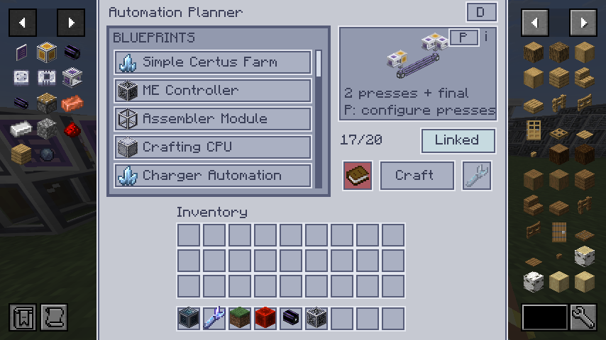
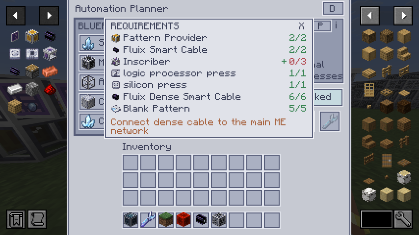
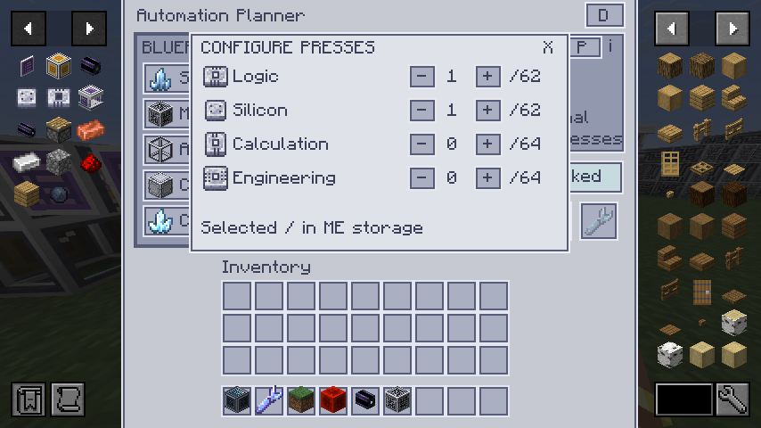
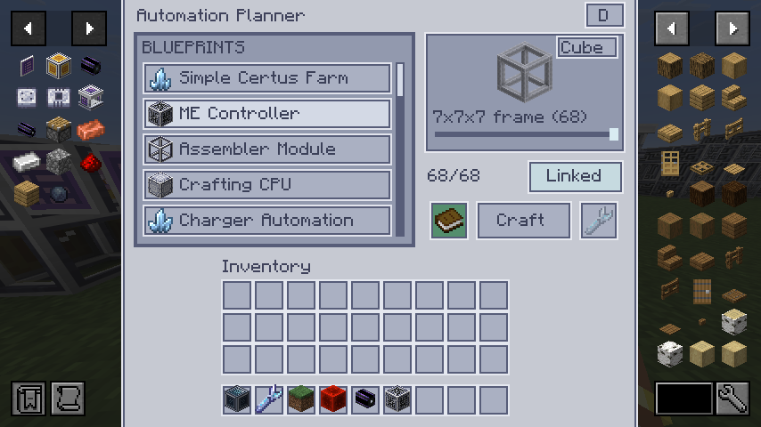
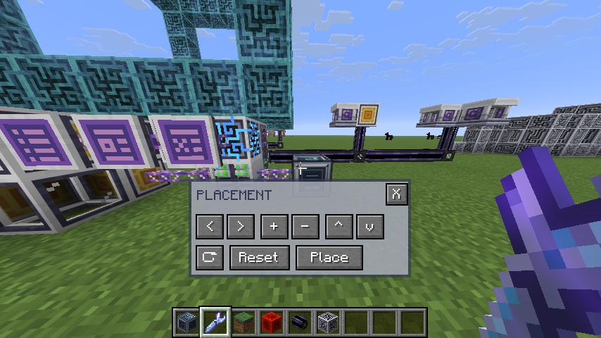

<div align="center">


An in-game builder for Applied Energistics 2 structures and automation setups.

[CurseForge](https://www.curseforge.com/minecraft/mc-mods/auto-ae2) (awaiting moderation)

</div>

Auto AE2 adds an Automation Planner and a Placement Wrench. You choose a blueprint, check the parts available in your ME system and use the wrench to position a hologram before building it. Some setups also come with configured components and processing patterns, so there is less to set up by hand.

The mod is still in development. The processor setup and its automatic pattern installation have been tested in the development world, while some other automation layouts still need complete crafting tests.

## Getting started

1. Craft an **Automation Planner** and a **Placement Wrench**, then connect the planner to a powered ME network.
2. Open the planner, choose a blueprint and adjust its size or options. The counter shows how many of the required items are available in ME storage.
3. Open the book to see the full material list. If the network knows patterns for missing items, **Craft** opens AE2's crafting confirmation. Requirements without a known pattern are skipped.
4. Put the wrench into the slot and select **Link**. You can then change the selected blueprint at the planner without inserting the wrench again.
5. Hold the wrench and press **G** to open the placement controls. Position and rotate the hologram, then select **Place**.

The planner takes the materials from ME storage when a structure is placed. Each placement needs a fresh set of materials, and the linked planner must be loaded in the same dimension. After placement, connect the structure to your network and provide any fuel or patterns listed by its blueprint.



## Materials and patterns

The requirements book lists each item with its available and required amount. A plus sign shows that the ME network has a pattern for that item. When JEI is installed, hover over a requirement and use **R** for recipes, **U** for uses or **A** to bookmark it.

The planner selects compatible smart cable colours from available storage and known patterns. A connected cable group uses one colour, and builds with isolated subnets use separate colours to keep those networks apart.



## Processor production

Select **Processor Production** and use the **P** button in the preview to choose how many of each press to install. The planner includes the presses and blank patterns in the material list, and places the matching processing patterns into the providers beside the correct inscribers. Connect the dense cable to your ME network after placement.



## Controller and placement controls

The controller blueprint has an **Array / Cube** toggle. Cube has eight stages, starting with one, two and three controllers, followed by hollow frames from 3×3×3 to 7×7×7. The slider changes the preview and the required number of controllers.



In the placement panel, use the arrow keys to move sideways or change distance, **Shift + Up / Down** to change height, and **R** to rotate. The same actions are available as buttons, along with reset and place.



## Current blueprints

The catalogue currently includes the Simple Certus Farm, controller arrays and frames, assembler modules, crafting CPUs, charger automation, processor production and furnace automation. Each design has its own requirements and may need a network connection or additional configuration after placement. The furnace layout has not yet had a complete in-game crafting test.

## Development

The project targets **Minecraft 26.1.2**, **NeoForge 26.1.2.109**, **Applied Energistics 2 26.1.13-beta** and **Java 25**. Open the project in IntelliJ, let Gradle import it and use the **Client** run configuration. Build with the included wrapper:

```shell
./gradlew build
```

On Windows, use `gradlew.bat build`. The jar is written to `build/libs`. JEI integration is optional and is not bundled with the mod. See [SETUP.md](SETUP.md) for more detail and [AGENTS.md](AGENTS.md) for the project architecture and testing notes.

Auto AE2 is licensed under the [MIT licence](LICENSE). NeoForged's template files retain their separate notice in [TEMPLATE_LICENSE.txt](TEMPLATE_LICENSE.txt).
